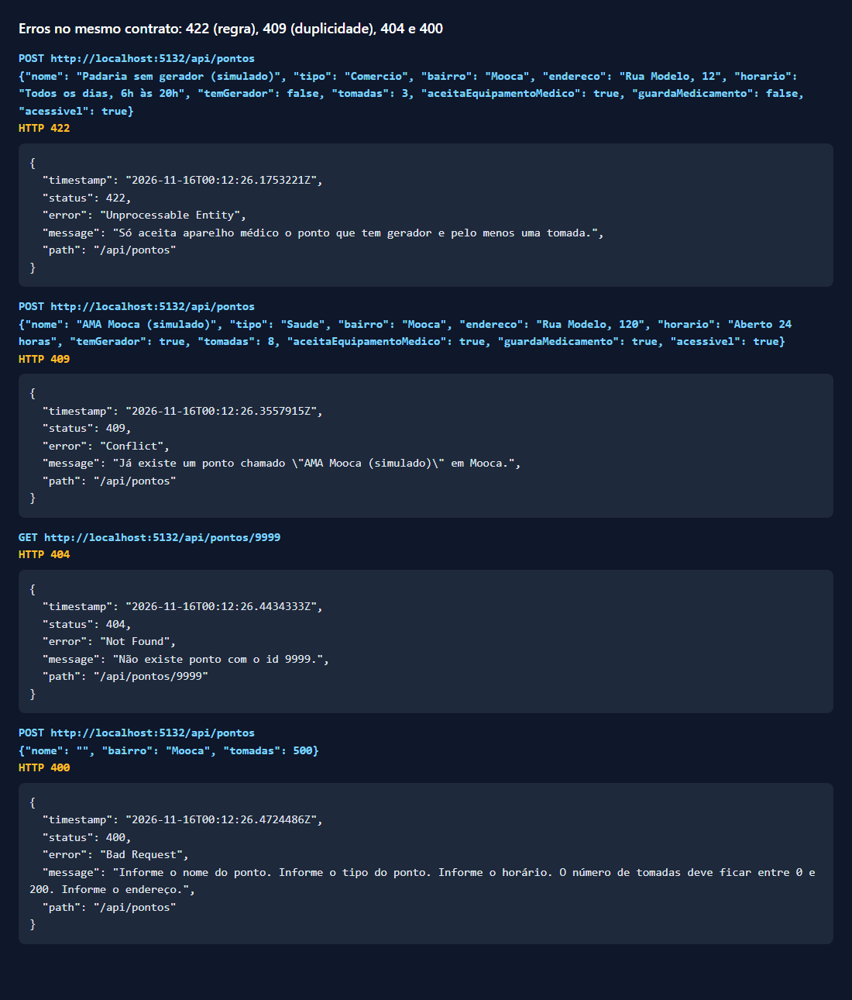
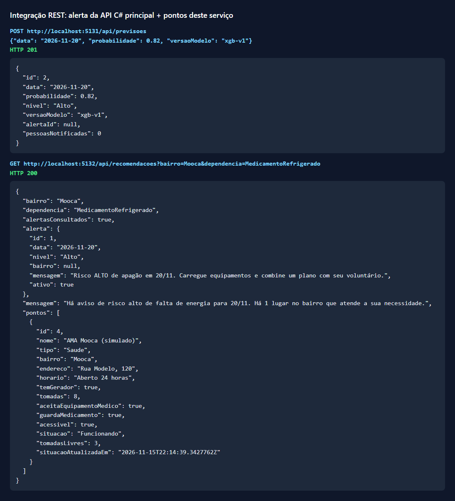
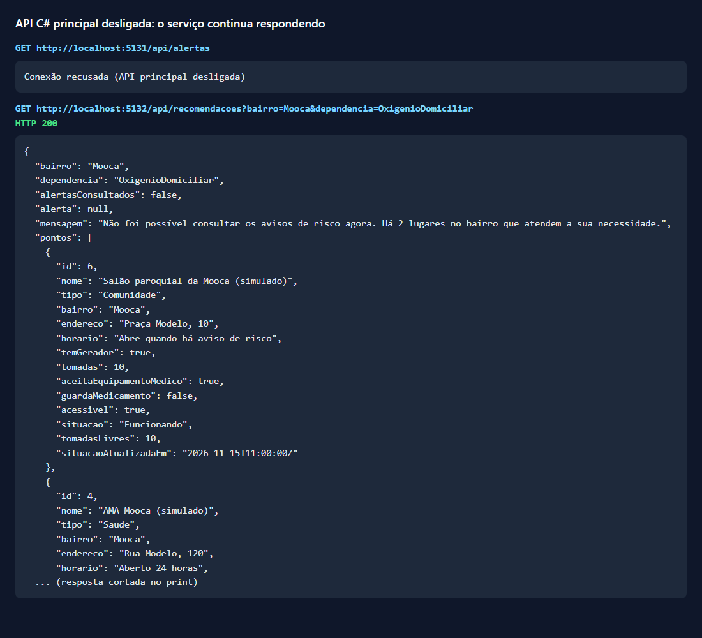

# Luz Vital - Pontos com energia (SOA e Web Services)

Global Solution CitizenTech, FIAP 2026.2, Engenharia de Software

Backend em C# (.NET 8) que guarda e serve os **pontos com energia** da Luz Vital: os lugares para onde quem depende de energia em casa pode ir durante um apagão (unidade de saúde, biblioteca, estação de metrô, comércio parceiro, espaço comunitário). É daqui que o app lê a aba "Lugares". O serviço também consulta, por REST, os alertas de risco da API C# principal para responder "há aviso para o meu bairro, e para onde eu vou?".

## Ficha da CitizenTech

| Campo | Conteúdo |
| --- | --- |
| Nome | Luz Vital |
| Cidade e bairro | São Paulo, área de concessão da Enel SP |
| Cidadão beneficiado | Quem depende de energia em casa (oxigênio domiciliar, insulina na geladeira, cadeira motorizada, idoso acamado) e quem cuida dessas pessoas |
| Problema, em uma frase | Quando um temporal derruba a energia, quem depende dela para viver não é avisado antes, não sabe quanto tempo vai ficar sem luz nem onde achar uma tomada, e ninguém vai checar se está bem |
| Como funciona | Um modelo treinado com dados do INMET e da ANEEL prevê os dias de risco de apagão. O app avisa os cadastrados com antecedência, aciona vizinhos voluntários para checar essas pessoas e mostra pontos com energia por perto |
| O que cada parte faz | `api-csharp/`: cidadãos, voluntários, alertas e check-ins; **serviço de pontos (este repositório)**: pontos com energia; [app do cidadão](https://github.com/arthurrmenezes/gs-mobile); [luzvital-ml](https://github.com/Caiorasuckkk/luzvital-ml): previsão do dia de risco; `cyber/`: proteção dos dados de saúde; `docs/`: requisitos e testes |
| Link do repositório | https://github.com/Caiorasuckkk/luzvital |
| Indicador de impacto | % de cadastrados avisados pelo menos 12h antes de um dia de risco e tempo até o primeiro check-in depois que a luz cai |
| ODS conectados | 3, 7, 10, 11 e 13 |

## Integrantes

- Arthur Albuquerque RM 562950
- Caio Rasuck RM 93645

## ODS: como este serviço contribui

| ODS | Contribuição |
| --- | --- |
| 3. Saúde e bem-estar | Quem usa oxigênio em casa ou guarda insulina na geladeira descobre, antes de a luz cair, onde ligar o aparelho ou guardar o remédio. A recomendação já filtra os lugares que servem para a necessidade da pessoa |
| 7. Energia limpa e acessível | Mapeia onde há energia garantida (gerador) e quantas tomadas estão livres, para que o acesso à energia não acabe junto com a luz de casa |
| 10. Redução das desigualdades | Olha primeiro para quem mais sofre no apagão: pessoas com deficiência, idosos acamados e doentes crônicos. Mostra quais lugares têm entrada sem degraus e funciona sem pedir cadastro nem dado pessoal |
| 11. Cidades e comunidades sustentáveis | Aproveita o que o bairro já tem (UBS, biblioteca, estação de metrô, comércio, salão comunitário) como rede de apoio em emergências |
| 13. Ação contra a mudança do clima | Temporais mais fortes derrubam a rede com mais frequência. O serviço é uma medida de adaptação: junta o alerta de risco com o lugar para onde ir |

Quem participa do ecossistema, do lado deste serviço: as unidades de saúde, bibliotecas e estações (poder público), o comércio parceiro e os espaços comunitários do bairro, que oferecem as tomadas; e os voluntários, que podem registrar como cada ponto está durante o apagão.

## Onde este serviço entra na solução

```
 modelo de ML ──previsão──▶ API C# principal (5131) ──alertas──▶ app do cidadão
                                     ▲                               │
                                     │ GET /api/alertas?bairro=      │ GET /api/pontos
                                     │                               ▼
                              serviço de pontos (5132, este repositório) ──▶ SQLite
```

Cada serviço é dono dos seus dados: a API principal cuida de pessoas, alertas e check-ins; este cuida dos lugares. Quando precisa do alerta, este serviço pergunta à API principal em vez de ler o banco dela. Se ela estiver fora do ar, ele continua respondendo, só sem a parte do alerta.

## Como rodar

Precisa do [.NET 8 SDK](https://dotnet.microsoft.com/download/dotnet/8.0) (ou mais novo).

```bash
dotnet restore
dotnet run --project src/LuzVital.Pontos.Api
```

Abra http://localhost:5132/swagger. O banco SQLite (`luzvital-pontos.db`) é criado sozinho na primeira execução, pelas migrations, já com 78 pontos fictícios em 38 bairros.

Testes:

```bash
dotnet test
```

### Junto com a API C# principal (opcional)

A rota `/api/recomendacoes` busca os alertas em `http://localhost:5131`, que é onde a `api-csharp` do [repositório principal](https://github.com/Caiorasuckkk/luzvital) sobe. Para ver as duas conversando:

```bash
# terminal 1, na pasta api-csharp do repositório principal
dotnet run --project src/LuzVital.Api

# terminal 2, nesta pasta
dotnet run --project src/LuzVital.Pontos.Api
```

Depois, crie um alerta na API principal (troque a data por hoje ou um dia futuro) e peça a recomendação:

```http
POST http://localhost:5131/api/previsoes
{ "data": "2026-11-20", "probabilidade": 0.82, "versaoModelo": "xgb-v1" }

GET http://localhost:5132/api/recomendacoes?bairro=Mooca&dependencia=MedicamentoRefrigerado
```

O endereço da API principal fica em `ApiAlertas:Url`, no `appsettings.json` (ou na variável de ambiente `ApiAlertas__Url`).

### Junto com o app

No `.env` do [app](https://github.com/arthurrmenezes/gs-mobile), defina `EXPO_PUBLIC_PONTOS_URL=http://localhost:5132`. A aba "Lugares" passa a ler deste serviço.

## Documentação dos endpoints

O Swagger é gerado a partir dos controllers e dos comentários do código: http://localhost:5132/swagger (o JSON do OpenAPI fica em `/swagger/v1/swagger.json`).

| Método | Rota | O que faz |
| --- | --- | --- |
| GET | `/api/pontos` | Lista os pontos. Filtros opcionais: `bairro`, `tipo`, `dependencia`, `somenteDisponiveis` |
| GET | `/api/pontos/{id}` | Consulta um ponto |
| POST | `/api/pontos` | Cadastra um ponto |
| PUT | `/api/pontos/{id}` | Corrige o cadastro |
| DELETE | `/api/pontos/{id}` | Remove o ponto e o histórico dele |
| POST | `/api/pontos/{id}/situacoes` | Registra como o ponto está agora: `Funcionando`, `Lotado`, `SemEnergia` ou `Fechado` |
| GET | `/api/pontos/{id}/situacoes` | Histórico de situações, do mais novo para o mais antigo |
| GET | `/api/pontos/resumo` | Resumo por bairro: pontos, com gerador, funcionando e tomadas livres |
| GET | `/api/recomendacoes?bairro=&dependencia=` | Alerta mais grave do bairro (vem da API principal) + pontos que estão funcionando e servem para a pessoa |

Todo erro responde no mesmo formato:

```json
{
  "timestamp": "2026-11-16T00:12:26Z",
  "status": 409,
  "error": "Conflict",
  "message": "Já existe um ponto chamado \"AMA Mooca (simulado)\" em Mooca.",
  "path": "/api/pontos"
}
```

| Status | Quando |
| --- | --- |
| `400` | Dado inválido ou faltando na requisição |
| `404` | Ponto que não existe |
| `409` | Já existe um ponto com o mesmo nome no bairro |
| `422` | Regra de negócio violada |
| `500` | Erro inesperado (sem detalhe interno na resposta) |

Exemplos prontos em `src/LuzVital.Pontos.Api/LuzVital.Pontos.Api.http`.

## Estrutura

```
src/
  LuzVital.Pontos.Domain/           entidades e regras de negócio, sem dependência externa
    Entities/                       PontoEnergia, RegistroSituacao
    Abstractions/                   IRepositorioPontos, IClienteAlertas, IRelogio
    Enums.cs, AlertaRisco.cs        tipos do domínio e o contrato dos alertas
    DomainException.cs              regra violada (422), não encontrado (404) e conflito (409)
  LuzVital.Pontos.Application/      camada de serviço: os fluxos da aplicação, sem saber de HTTP nem de banco
    Servicos/                       ServicoPontos, ServicoRecomendacao
  LuzVital.Pontos.Infrastructure/   EF Core + SQLite e a chamada REST
    Data/                           PontosDbContext, RepositorioPontos, PontosSimulados (dados fictícios)
    Migrations/                     Inicial, HistoricoDeSituacao, PontosSimulados
    Integracao/                     ClienteAlertasHttp (chama a API C# principal)
    Servicos/                       RelogioSistema
  LuzVital.Pontos.Api/              controllers, DTOs, contrato e tratamento de erros, Swagger
tests/
  LuzVital.Pontos.Tests/            xUnit: domínio, chamada REST e a API inteira
```

As dependências apontam para dentro: `Api` usa `Application`, que usa `Domain`. `Infrastructure` implementa as interfaces que o `Domain` declara (`IRepositorioPontos`, `IClienteAlertas`, `IRelogio`), então nem o domínio nem os serviços conhecem o EF Core ou o `HttpClient`.

## Domínio

- `PontoEnergia` é a entidade principal. Os setters são privados: o cadastro só muda por `Atualizar` e a situação só muda por `RegistrarSituacao`, que também cria a linha do histórico (`RegistroSituacao`).
- `Atende(dependencia)` diz se o ponto serve para a pessoa, e `PodeReceber` diz se dá para mandar alguém para lá agora.

Regras de negócio:

- Só aceita aparelho médico o ponto que tem gerador e pelo menos uma tomada
- O ponto tem de 0 a 200 tomadas; nome, bairro, endereço e horário são obrigatórios
- Não pode haver dois pontos com o mesmo nome no mesmo bairro (responde 409)
- Ponto novo nasce `Funcionando`, com todas as tomadas livres
- As tomadas livres nunca passam do total; `Funcionando` com zero tomadas livres é recusado (o certo é registrar `Lotado`)
- `Lotado`, `SemEnergia` e `Fechado` zeram as tomadas livres, e o ponto sai das recomendações
- `Fechado` exige o motivo na observação

Quem cada ponto atende:

| Dependência | O ponto precisa |
| --- | --- |
| `OxigenioDomiciliar` | Aceitar aparelho médico (logo, ter gerador) |
| `MedicamentoRefrigerado` | Guardar remédio na geladeira |
| `CadeiraMotorizada` | Ter entrada sem degraus e tomada |
| `AcamadoComEquipamento` | Aceitar aparelho médico e ter entrada sem degraus |
| `Outro` | Ter tomada |

## Banco de dados

SQLite com EF Core 8. A configuração fica em `PontosDbContext`.

| Tabela | O que guarda |
| --- | --- |
| `PontosEnergia` | Os pontos, com a situação atual e as tomadas livres |
| `RegistrosSituacao` | Histórico de situações de cada ponto (chave estrangeira com exclusão em cascata) |

As regras que cabem no banco também estão lá, como restrições `CHECK` (faixa de tomadas, tomadas livres até o total, aparelho médico só com gerador) e índice único de nome + bairro. Os enums são gravados como texto. O bairro tem uma cópia em maiúsculas (`BairroNormalizado`) para a busca funcionar com "Mooca", "mooca" ou "MOOCA", que é como a API principal escreve.

## Migrations

Ficam em `src/LuzVital.Pontos.Infrastructure/Migrations/` e são aplicadas com `Migrate()` quando a API sobe.

| Migration | O que faz |
| --- | --- |
| `Inicial` | Cria `PontosEnergia`, com as restrições e os índices |
| `HistoricoDeSituacao` | Cria `RegistrosSituacao`, ligada ao ponto |
| `PontosSimulados` | Grava os 78 pontos fictícios (os mesmos lugares de demonstração do app) |

Para criar uma nova depois de mudar o modelo:

```bash
dotnet tool install --global dotnet-ef
dotnet ef migrations add NomeDaMudanca -p src/LuzVital.Pontos.Infrastructure
```

## Testes automatizados

51 testes em xUnit (`dotnet test`):

- `DominioTests`: as regras de `PontoEnergia`, sem banco.
- `ClienteAlertasHttpTests`: a chamada REST para a API principal, com a rede trocada por uma falsa. Confere a leitura do JSON no formato real e o que acontece quando ela cai, responde erro ou demora.
- `ApiTests`: sobe a API inteira em memória (`WebApplicationFactory`) com um SQLite em memória criado pelas migrations de verdade. Cobre filtros, cadastro, 400/404/409/422 e o contrato de erro, situação e histórico, exclusão em cascata, resumo, recomendação com e sem a API de alertas, e o Swagger.

## Conceitos da disciplina aplicados

| Conceito visto em aula | Onde está no projeto |
| --- | --- |
| SOA: serviços independentes, com responsabilidade clara e contrato | Este serviço cuida só dos pontos e tem banco próprio; a API principal cuida de pessoas e alertas. Um não lê o banco do outro |
| Camadas Controller, Service e Repository | Um projeto por camada: `PontosController` (Api) só recebe e devolve; `ServicoPontos` (Application) tem os fluxos; `RepositorioPontos` (Infrastructure) é a única classe que consulta o banco |
| Regra de negócio fora do controller | As regras ficam em `PontoEnergia` e nos serviços, e são testadas sem HTTP nem banco |
| Verbos HTTP e status codes | GET, POST, PUT e DELETE em recursos no plural; 200, 201, 204, 400, 404, 409, 422 e 500 |
| Contrato de erro padronizado e handler global | Todo erro responde `timestamp`, `status`, `error`, `message` e `path` (`TratamentoDeErros.cs`). O erro 500 nunca mostra detalhe interno |
| Baixo acoplamento: depender de abstrações | O serviço depende de `IRepositorioPontos`, `IClienteAlertas` e `IRelogio`, não das implementações. Por isso os testes trocam a API de alertas por uma falsa |
| Comunicação síncrona entre sistemas | `GET /api/alertas` na API principal, por REST |
| Resiliência: timeout e fallback | A chamada tem tempo limite de 3 segundos. Se a API principal cair ou demorar, a recomendação responde sem o alerta e avisa em `alertasConsultados` |
| Swagger / OpenAPI | Gerado do código, com os schemas e os status codes de cada rota |
| Pirâmide de testes | Muitos testes unitários de domínio, alguns de integração (API + banco + migrations) e um de contrato do JSON da API principal. Cobrem o caminho feliz e os erros |
| Stateless | O serviço não guarda sessão: o estado fica todo no banco, então dá para subir mais de uma instância |

Decisões e o que ficou de fora (trade-offs):

- **Síncrono em vez de mensageria.** A recomendação precisa do alerta na hora de responder, então a chamada é direta. O acoplamento que isso cria é contido pelo tempo limite e pelo fallback. Uma fila só valeria a pena se o serviço precisasse reagir a cada alerta novo.
- **Sem retry.** Quem espera a resposta é uma pessoa com o celular na mão durante um temporal. Tentar de novo dobraria a espera; é melhor responder logo sem o alerta.
- **Sem autenticação.** As consultas são públicas de propósito: o app não tem login e os dados não são pessoais. As rotas que alteram dados (cadastro e situação) deveriam exigir JWT com perfil de voluntário ou administrador antes de ir para produção.
- **Sem versão na rota** (`/v1`). O contrato tem um consumidor só, o app, que evolui junto. Os campos novos (`situacao`, `tomadasLivres`) foram adicionados sem quebrar o que o app já lia.
- **SQLite.** Roda em qualquer máquina sem instalar nada, o que serve para o protótipo. Trocar por PostgreSQL muda só a configuração do EF Core e as migrations.

## Dados

Todos os pontos e endereços são fictícios (trazem "(simulado)" no nome). O serviço não guarda nenhum dado pessoal: quem pede uma recomendação informa só o bairro e o tipo de dependência, e nada disso é gravado.

## Evidências

Os prints mostram respostas reais do serviço rodando nesta máquina.

1. Testes passando: os 51 testes de domínio, da chamada REST e da API.


2. Swagger: a API no ar com todos os endpoints documentados.


3. Migrations aplicadas: as três no histórico do EF Core, e as tabelas criadas e povoadas por elas.


4. Pontos de um bairro: filtro por bairro (sem diferenciar maiúsculas) e por dependência.


5. Erros padronizados: regra de negócio (422), ponto repetido (409), ponto que não existe (404) e dado inválido (400), todos no mesmo contrato.



6. Situação e histórico: o registro de "funcionando com 3 tomadas livres" e de "lotado", e o histórico do ponto.


7. Integração REST: uma previsão enviada à API C# principal abre o alerta, e a recomendação deste serviço já vem com ele.



8. API principal desligada: a recomendação continua respondendo, avisando que não conseguiu consultar os alertas.



9. Resumo por bairro: consulta agrupada no banco.


## Uso de IA

Registrado em [prompts.md](prompts.md).
