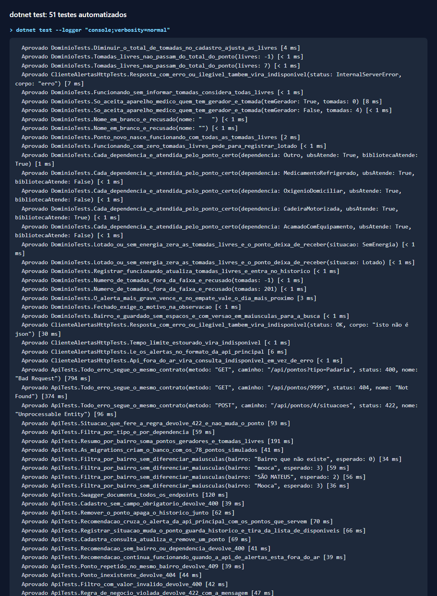
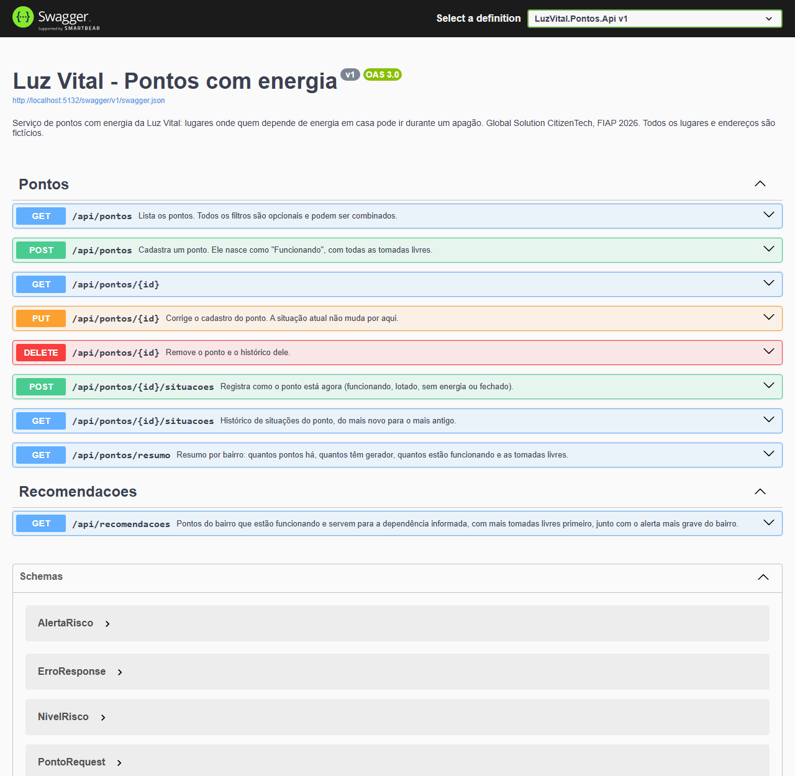
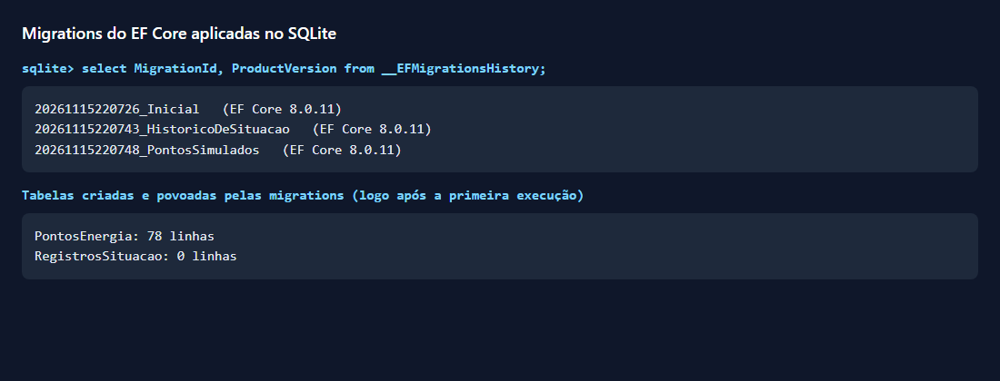
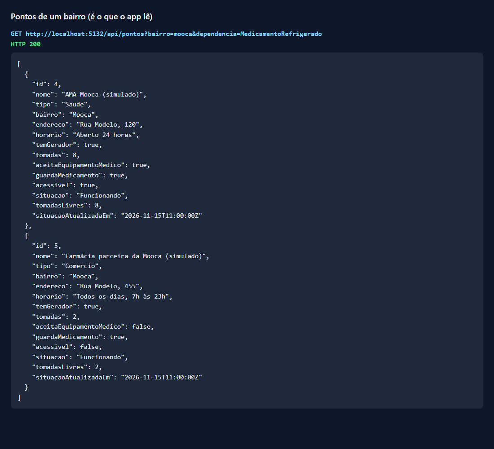
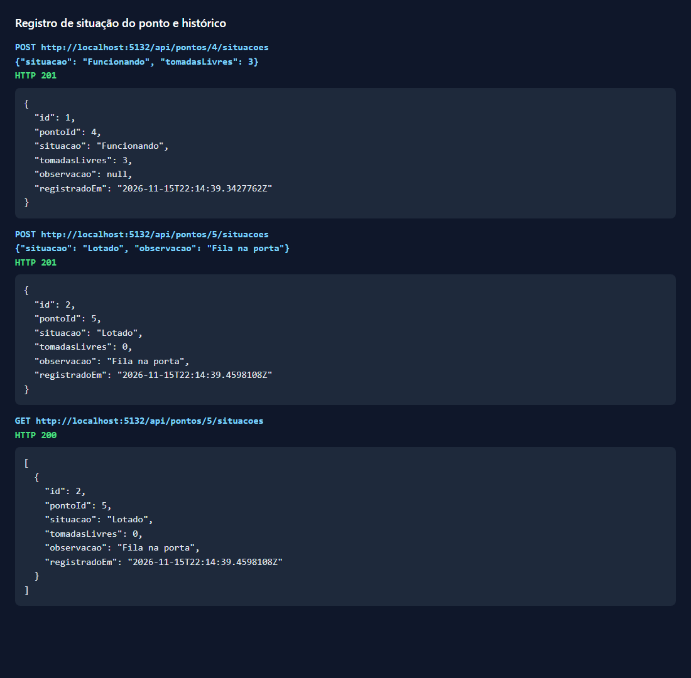
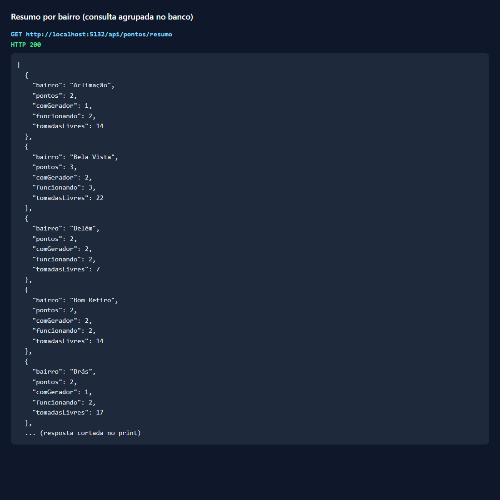

# Luz Vital - Pontos com energia (SOA e Web Services)

Global Solution CitizenTech, FIAP 2026.2, Engenharia de Software

API REST em C# (.NET 8) com os **pontos com energia** da Luz Vital: os lugares para onde quem depende de energia em casa pode ir durante um apagão. É daqui que o [app do cidadão](https://github.com/arthurrmenezes/gs-mobile) lê a aba "Lugares". O serviço também consulta os alertas de risco da API principal para responder "há aviso para o meu bairro, e para onde eu vou?".

## Ficha da CitizenTech

| Campo | Conteúdo |
| --- | --- |
| Nome | Luz Vital |
| Cidade e bairro | São Paulo, área de concessão da Enel SP |
| Cidadão beneficiado | Quem depende de energia em casa (oxigênio domiciliar, insulina na geladeira, cadeira motorizada, idoso acamado) e quem cuida dessas pessoas |
| Problema, em uma frase | Quando um temporal derruba a energia, quem depende dela para viver não é avisado antes, não sabe quanto tempo vai ficar sem luz nem onde achar uma tomada, e ninguém vai checar se está bem |
| Como funciona | Um modelo treinado com dados do INMET e da ANEEL prevê os dias de risco de apagão. O app avisa os cadastrados com antecedência, aciona vizinhos voluntários para checar essas pessoas e mostra pontos com energia por perto |
| O que cada parte faz | `api-csharp/`: cidadãos, voluntários, alertas e check-ins; **serviço de pontos (este repositório)**: pontos com energia; [app do cidadão](https://github.com/arthurrmenezes/gs-mobile); [luzvital-ml](https://github.com/Caiorasuckkk/luzvital-ml): previsão do dia de risco; `cyber/`: proteção dos dados de saúde; `docs/`: requisitos e testes |
| Link do repositório | https://github.com/Caiorasuckkk/luzvital |
| Indicador de impacto | % de cadastrados avisados pelo menos 12h antes de um dia de risco e tempo até o primeiro check-in depois que a luz cai |
| ODS conectados | 3, 7, 10, 11 e 13 |

Como este serviço contribui para os ODS:

- **3, Saúde:** quem usa oxigênio ou guarda insulina descobre, antes de a luz cair, onde ligar o aparelho ou guardar o remédio.
- **7, Energia:** mostra onde há gerador e quantas tomadas estão livres.
- **10, Desigualdades:** atende primeiro quem mais sofre no apagão (pessoas com deficiência, acamados, doentes crônicos) e informa quais lugares têm entrada sem degraus.
- **11, Cidades:** usa o que o bairro já tem (UBS, biblioteca, metrô, comércio, salão comunitário) como rede de apoio.
- **13, Clima:** é uma medida de adaptação aos temporais, que derrubam a rede cada vez mais.

## Integrantes

- Arthur Albuquerque RM 562950
- Caio Rasuck RM 93645

## Como rodar

**Opção 1, com Docker** (não precisa instalar o .NET):

```bash
docker compose up --build
```

**Opção 2, com o .NET** ([SDK 8](https://dotnet.microsoft.com/download/dotnet/8.0) ou mais novo; confira com `dotnet --version`):

```bash
dotnet run --project src/LuzVital.Pontos.Api
dotnet test          # 51 testes
```

Nos dois casos, abra **http://localhost:5132/swagger**. Não há banco para instalar: o SQLite é criado pelas migrations na primeira execução, já com 78 pontos fictícios.

Para ver a integração entre os serviços, suba também a `api-csharp` do [repositório principal](https://github.com/Caiorasuckkk/luzvital) (`dotnet run --project src/LuzVital.Api`, porta 5131). Sem ela, tudo funciona; a recomendação só vem sem o alerta.

## Endpoints

A documentação completa é o Swagger, gerado a partir do código.

| Método | Rota | O que faz |
| --- | --- | --- |
| GET | `/api/pontos` | Lista os pontos. Filtros: `bairro`, `tipo`, `dependencia`, `somenteDisponiveis` |
| GET | `/api/pontos/{id}` | Consulta um ponto |
| POST | `/api/pontos` | Cadastra um ponto |
| PUT | `/api/pontos/{id}` | Corrige o cadastro |
| DELETE | `/api/pontos/{id}` | Remove o ponto e o histórico dele |
| POST | `/api/pontos/{id}/situacoes` | Registra como o ponto está: `Funcionando`, `Lotado`, `SemEnergia` ou `Fechado` |
| GET | `/api/pontos/{id}/situacoes` | Histórico de situações do ponto |
| GET | `/api/pontos/resumo` | Totais por bairro |
| GET | `/api/recomendacoes?bairro=&dependencia=` | Alerta do bairro (vem da API principal) + pontos que servem para a pessoa |

Todo erro responde no mesmo formato (`timestamp`, `status`, `error`, `message`, `path`): 400 para dado inválido, 404 para ponto inexistente, 409 para ponto repetido e 422 para regra de negócio.

## O que foi aplicado da disciplina

| Critério | Onde está |
| --- | --- |
| Estruturação do domínio | `PontoEnergia` e `RegistroSituacao` (`src/LuzVital.Pontos.Domain`), com setters privados e as regras dentro da entidade. Exemplos: só aceita aparelho médico o ponto que tem gerador; as tomadas livres nunca passam do total; "Fechado" exige o motivo |
| Conexão com banco de dados | EF Core 8 + SQLite. Duas tabelas ligadas por chave estrangeira, com restrições `CHECK` e índice único. `RepositorioPontos` é a única classe que consulta o banco |
| Migrações | Três, aplicadas sozinhas ao subir: `Inicial`, `HistoricoDeSituacao` e `PontosSimulados` (`src/LuzVital.Pontos.Infrastructure/Migrations`) |
| Documentação automática | Swagger/OpenAPI em `/swagger`, com schemas e status codes de cada rota |
| Testes automatizados | 51 testes xUnit: regras do domínio, chamada REST e a API inteira com banco em memória criado pelas migrations |
| Chamada a API REST | `/api/recomendacoes` chama `GET /api/alertas` da API C# principal, com tempo limite de 3 segundos. Se ela não responder, o serviço devolve os pontos sem o alerta |

Um projeto por camada: `Api` (controllers) → `Application` (serviços) → `Domain` (entidades e interfaces), e `Infrastructure` (banco e chamada REST) implementa as interfaces do domínio. Cada serviço da Luz Vital é dono dos seus dados: este cuida dos lugares, a API principal cuida de pessoas e alertas, e um não lê o banco do outro.

Ficou de fora, por ser protótipo: autenticação (as consultas são públicas e não há dado pessoal; as rotas de escrita precisariam de JWT em produção) e mensageria (a recomendação precisa do alerta na hora, então a chamada é síncrona).

## Evidências

Respostas reais do serviço rodando. Todos os pontos e endereços são fictícios.

**1. Testes passando**



**2. Swagger com todos os endpoints**



**3. Migrations aplicadas no banco**



**4. Pontos de um bairro, filtrados por dependência**



**5. Erros padronizados: 422, 409, 404 e 400**


**6. Registro de situação e histórico do ponto**



**7. Integração REST: a previsão enviada à API principal abre o alerta, e a recomendação já vem com ele**


**8. API principal desligada: o serviço continua respondendo**


**9. Resumo por bairro**



## Uso de IA

Registrado em [prompts.md](prompts.md).
